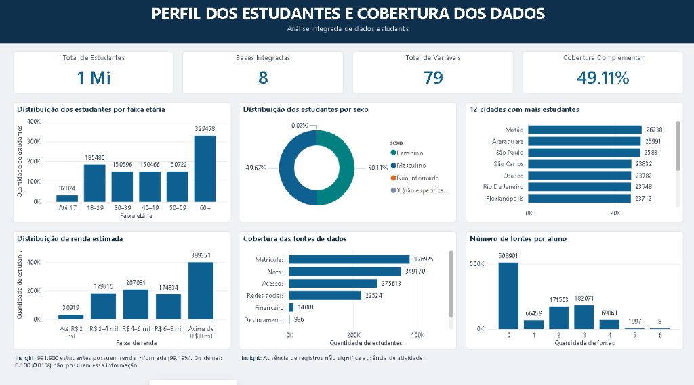
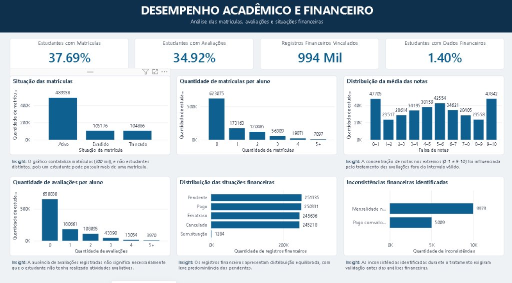
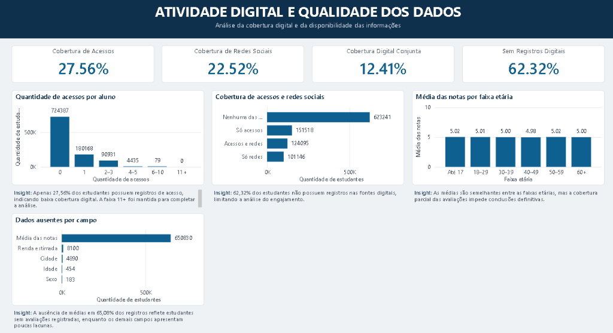
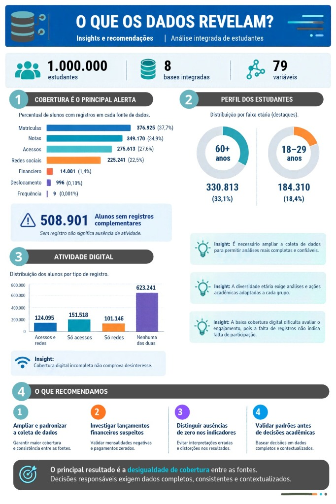

# Trabalho Final - Mineração de Dados (P2)

Análise de dados acadêmicos realizada para a disciplina de Mineração de Dados (FATEC Matão-SP, curso de Desenvolvimento de Software Multiplataforma, Prof. Rodrigo Vidrich), seguindo as etapas de KDD e CRISP-DM sobre 8 bases integradas (1.000.000 de estudantes).

## Integrantes

- Jerônimo Barbieri Junior
- Luan Chierato Oliveira
- Miguel Miranda Morandini
- Victor Hugo Malipense Testi

## Dashboard (Power BI)

O painel está disponível em [powerbi/TrabalhoFinal_Mineracao.pbix](powerbi/TrabalhoFinal_Mineracao.pbix) e [powerbi/TrabalhoFinal_Mineracao.pbip](powerbi/TrabalhoFinal_Mineracao.pbip), dividido em três páginas:

### Perfil dos Estudantes e Cobertura dos Dados
Visão demográfica (faixa etária, sexo, cidades e renda estimada) e levantamento da cobertura de registros entre as 8 fontes da base.



### Desempenho Acadêmico e Financeiro
Distribuição das matrículas (700 mil registros), notas e avaliações por aluno, situações financeiras e inconsistências identificadas (mensalidades negativas e pagamentos com valor zero).



### Atividade Digital e Qualidade dos Dados
Cobertura de acessos ao portal e redes sociais, média de notas por faixa etária e volume de valores ausentes por campo.



## Infográfico

Link no Canva: https://canva.link/y77usc1mz1c0jbk



## Quadro de Técnicas

A tabela completa está em [Quadro_Tecnicas_Mineracao_Dados.xlsx](Quadro_Tecnicas_Mineracao_Dados.xlsx). Abaixo está o resumo por etapa:

| Etapa | Técnicas | Aplicação no trabalho |
| :--- | :--- | :--- |
| Planejamento e Seleção | KDD, CRISP-DM e seleção de dados | Definição do fluxo do projeto e escolha das 8 bases e variáveis usadas na análise. |
| Pré-processamento | Limpeza, padronização, conversão de tipos, duplicatas, ausentes, regras, IQR/Z-Score e LGPD | Correção de delimitadores mistos (`\|` e `;`), mojibake, datas, números em padrão brasileiro, validação de notas (`0–10`) e idades, flags de ausência, detecção de outliers e anonimização de nomes com SHA-256. |
| Preparação e Transformação | Camadas Bronze/Silver/Gold, ETL, Star Schema, agregação, feature engineering e binning | Organização em camadas, junção pelo `id_aluno` em tabelas dimensão e fato, cálculo de indicadores por aluno e agrupamento em faixas. |
| Análise Exploratória | Estatística descritiva, frequência, cobertura, interseção e correlação (Pearson/Spearman) | Cálculo de médias, medianas, dispersão, cobertura entre fontes e correlações em `data/gold/`. |
| Mineração e Avaliação | Amostragem, balanceamento (Undersampling, Oversampling, SMOTE), Regressão Logística, Árvore de Decisão, Random Forest, Regressão Linear, K-Means, Regras de Associação e ARS | Comparação de técnicas de amostragem e modelos preditivos, avaliação com F1, ROC-AUC, validação cruzada, bootstrap e silhueta, regras (suporte, confiança e lift), grafo faculdade-curso e benchmark com dados do INEP. |
| Interpretação | Dashboard em Power BI, DAX e infográfico | Painel interativo com 3 páginas e síntese visual dos achados e recomendações. |

## Estrutura do Repositório

- `notebooks/01_bronze/` - ingestão dos arquivos originais e diagnóstico inicial
- `notebooks/02_silver/` - limpeza, padronização, outliers e anonimização
- `notebooks/03_gold/` - modelagem Star Schema, estatísticas, amostragem, ML, regras e ARS
- `notebooks/utils/` - funções auxiliares compartilhadas
- `data/` - resumos e métricas geradas em CSV e JSON (arquivos Parquet e bases brutas não são versionados pelo tamanho)
- `powerbi/` - arquivos do Power BI (`.pbix`, `.pbip`) e prints em `powerbi/prints/`
- `infografico/` - imagem do infográfico
- `Quadro_Tecnicas_Mineracao_Dados.xlsx` - quadro completo de técnicas utilizadas

## Como Executar

Com Python 3.12+ e os arquivos originais na pasta `Bases TRabalho Final/`:

```powershell
python -m venv .venv
.\.venv\Scripts\Activate.ps1
pip install -r requirements.txt
```

Execução das camadas em ordem:

```powershell
Get-ChildItem "notebooks\01_bronze\*.py" | Sort-Object Name | ForEach-Object { .\.venv\Scripts\python.exe $_.FullName }
Get-ChildItem "notebooks\02_silver\*.py" | Sort-Object Name | ForEach-Object { .\.venv\Scripts\python.exe $_.FullName }
Get-ChildItem "notebooks\03_gold\*.py"   | Sort-Object Name | ForEach-Object { .\.venv\Scripts\python.exe $_.FullName }
```

Para abrir o painel diretamente, utilize [powerbi/TrabalhoFinal_Mineracao.pbix](powerbi/TrabalhoFinal_Mineracao.pbix). Caso utilize o projeto `.pbip` após rodar o pipeline, atualize o caminho da pasta `data/gold/` nas configurações da fonte de dados do Power BI Desktop.
